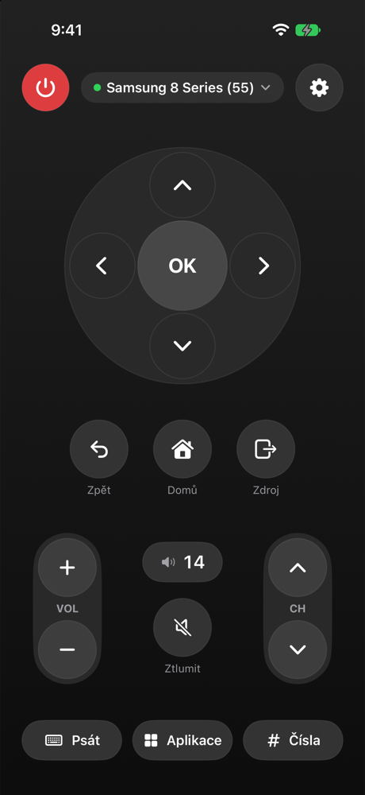

# TV Remote

An iPhone app for controlling Samsung TVs running Tizen over your home Wi-Fi.
No cloud, no Samsung account and no SmartThings. The phone talks to the TV directly.

The remote is a Swift package, so it can also be embedded in another app. The standalone app
lives in the `App/` folder.

<p align="center">
  
</p>

## Features

- **Classic remote:** arrows and OK, Back, Home, Source, volume, channels, mute and power.
- **Holding a key** works like a physical remote: arrows, volume and channels repeat, other keys
  send a real long press (e.g. holding OK opens programme info).
- **Volume by number:** a slider or an exact value from 0 to 100. The current volume and mute state are read from the TV.
- **Volume with the iPhone's side buttons** while the app is open.
- **Typing from the phone's keyboard** into search in YouTube, Netflix and others. The panel opens by itself as soon as the TV shows its keyboard.
- **TV apps:** a list of installed apps, open one with a tap, favourites pinned right on the remote.
- **Colour buttons** (red, green, yellow, blue) for teletext, HbbTV and app menus.
- **Number pad** for choosing a channel directly.
- **Turning the TV on** via Wake-on-LAN.
- **Multiple TVs:** network discovery, each TV has its own pairing and favourite apps, switch with a tap.
- **Siri and Shortcuts:** turn on/off, mute, set or change the volume, open an app.

## How it works

Samsung Tizen TVs expose several interfaces on the network. The app uses these:

| What | Interface | Port |
|---|---|---|
| Keys, apps, typing text | WebSocket API (`samsung.remote.control`) over TLS, token pairing | 8002 |
| Finding TVs | Bonjour, the Smart View service `_samsungmsf._tcp` | – |
| TV details (model, MAC, state) | REST API `/api/v2/` | 8001 |
| Exact volume and mute | UPnP `RenderingControl` (SOAP) | 9197 |
| Power on | Wake-on-LAN, magic packet over UDP | 9 |

On the first connection the TV asks for permission. Once you allow it, it issues a token that the
app stores, and later connections go through without asking.

The app finds TVs via Bonjour, not SSDP. SSDP needs a multicast entitlement from Apple that a free
developer account doesn't get. Bonjour is handled by the system, so it works without one.

## Compatibility

Samsung Tizen TVs that support token pairing, roughly 2017 models and newer. Discovery only offers
TVs that advertise this support themselves (`TokenAuthSupport`).

Tested on:
- Samsung UE55RU8002 (RU8000 series, 2019)
- Samsung UE32T5372 (T5300 series, 2020)

## Installation

The app isn't on the App Store. You install it on your own iPhone from Xcode.

1. Open `App/SamsungTVRemote.xcodeproj` in Xcode 27 or later.
2. In *Signing & Capabilities* choose your team. A free Apple ID (Personal Team) is enough.
   If the bundle ID is taken, change it to your own.
3. On the iPhone turn on *Settings → Privacy & Security → Developer Mode* and run the app from Xcode.
4. Allow the app **local network access**.

With a free account the app's signature expires after 7 days and it has to be installed again from Xcode.

### TV setup

- The TV and the phone must be on the same network.
- For Wake-on-LAN: *Settings → General → Network → Expert Settings → Power On with Mobile*.
- A fixed IP address for the TV (a reservation in your router) helps, so it doesn't have to be found again after a router restart.

## Project structure

```
Package.swift                  # the TVRemote Swift package
Sources/TVRemote/
├── TVRemote.swift             # the package's public interface
├── SamsungTVClient.swift      # TV connection, keys, apps, text, switching TVs
├── TVConfig.swift             # saved TVs (UserDefaults)
├── TVDiscovery.swift          # finding TVs via Bonjour
├── TVVolume.swift             # volume and mute via UPnP
├── WakeOnLAN.swift            # magic packet for power on
├── TVIntents.swift            # Siri and Shortcuts actions
├── VolumeButtonObserver.swift # iPhone side buttons
├── ContentView.swift          # remote screen
├── RemoteControls.swift       # buttons, D-pad, repeat and long press
└── …Sheet.swift, SettingsView.swift
App/                           # standalone app: project, icon, Siri phrases
Tools/faketv.py                # fake TV for testing
Design/AppIcon/                # Blender scripts the icon was rendered from
```

## Using it as a package

```swift
import AppIntents
import SwiftUI
import TVRemote

// The main screen. It connects to the TV by itself and disconnects when it disappears.
TVRemoteView()

// Name, SF Symbol and colour, e.g. for a launcher with several apps.
TVRemote.name; TVRemote.systemImage; TVRemote.tint

// The Siri and Shortcuts actions live in the package, but the system only finds them through the app's AppIntentsPackage.
struct MyAppIntents: AppIntentsPackage {
    static var includedPackages: [any AppIntentsPackage.Type] { [TVRemoteIntents.self] }
}
```

Xcode doesn't find ready-made Siri phrases (`AppShortcutsProvider`) in a package, so the app builds
them itself from the public actions (`MuteTVIntent`, `SetTVVolumeIntent`, `AdjustTVVolumeIntent`,
`TurnOffTVIntent`, `TurnOnTVIntent`, `OpenTVAppIntent`) and plugs its provider's
`updateAppShortcutParameters()` into `TVRemote.appShortcutParametersChanged`.
See `App/SamsungTVRemote/` for an example.

The app also needs these in Info.plist:

- `NSLocalNetworkUsageDescription`
- `NSBonjourServices` with the entry `_samsungmsf._tcp` (finding TVs)

## Testing without a TV

`Tools/faketv.py` imitates the TV's WebSocket API on `127.0.0.1:8002` and prints everything the app sends:

```bash
python3 Tools/faketv.py
xcrun simctl launch booted cz.jakublanger.SamsungTVRemote -tv.testHost 127.0.0.1
```

The launch argument `-tv.testHost` redirects the app for that launch only; the stored settings stay
unchanged (at least one TV must be saved in the app). The simulator uses the Mac's network, so when
the Mac is on the same Wi-Fi as the TV, you can also try the app against a real TV straight from
the simulator.

## Limitations

- The iPhone side buttons work through an unofficial approach (iOS has no public API for it).
- Siri phrases are in English only.
- Wake-on-LAN sends the packet straight to the TV's IP, because iOS blocks broadcast without a
  multicast entitlement. A TV in deep sleep may occasionally miss it.

---

A personal project, not affiliated with Samsung. Samsung, Tizen and Smart View are trademarks of
their respective owners.
